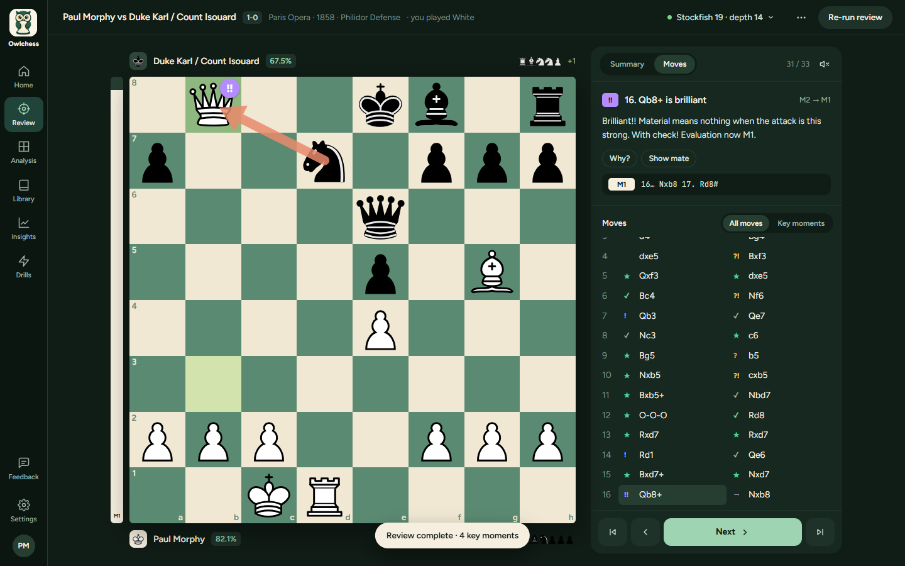
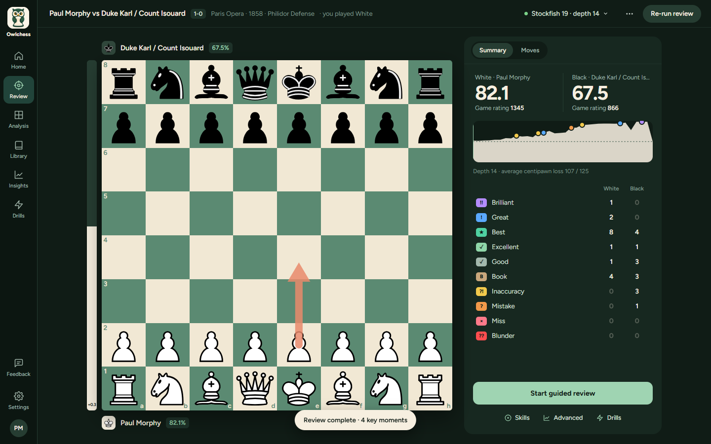
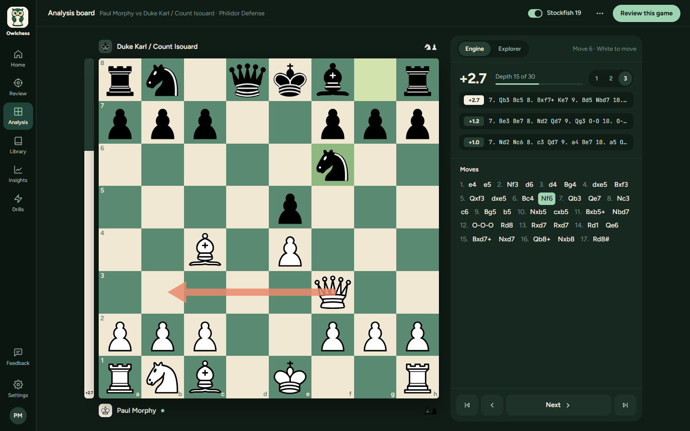
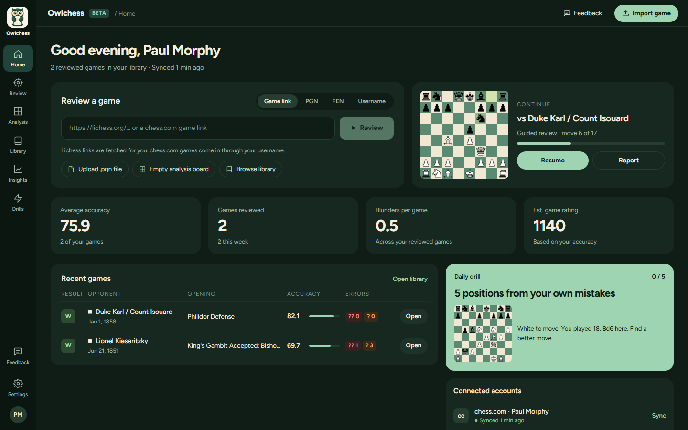
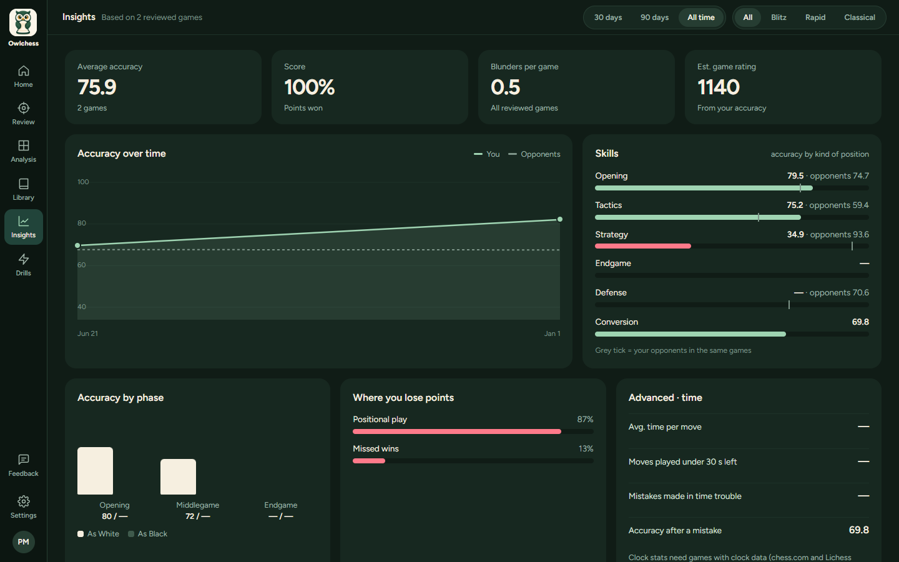
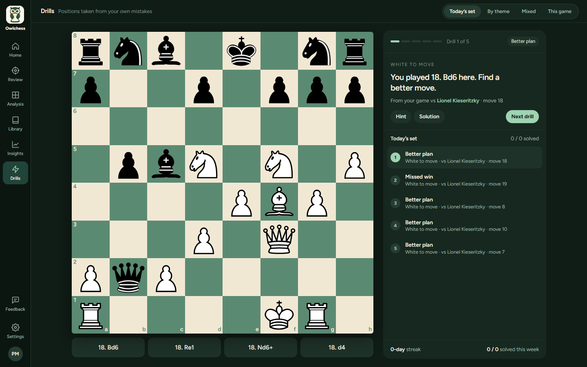
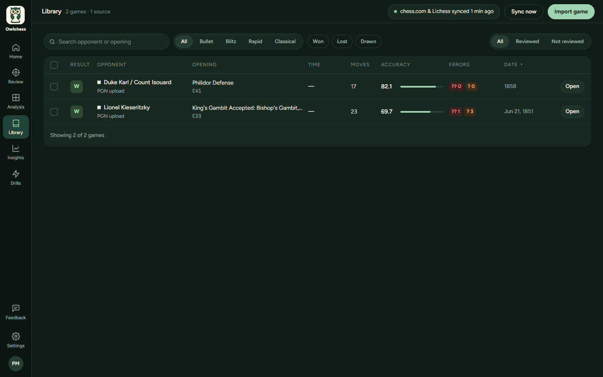

# Owlchess

Private chess game review that runs entirely in your browser. Stockfish analyses every move,
rates it (Brilliant → Blunder), scores both players' accuracy, and a coach walks you through the
game. Your games build into a local library that powers Insights and drills made from your own
mistakes. No account, no server, no telemetry — nothing leaves your machine except the imports
you ask for.

**Public beta (v0.3).** Try it at **https://codeneuron58.github.io/Owlchess/** — and please
[report bugs or ask for features](https://github.com/CodeNeuron58/Owlchess/issues/new/choose)
(there is also a Feedback link in the app).



| | |
|---|---|
|  |  |
|  |  |
|  |  |

## Run it

```bash
npm install        # also copies the Stockfish builds into public/engines/
npm run dev        # → http://localhost:5173
npm run build      # production build
npm run test       # unit tests (vitest)
npm run lint       # oxlint
```

### Deploy (GitHub Pages)

The app is a static site. `.github/workflows/deploy.yml` tests, builds with
`BASE_PATH=/<repo>/` and publishes `dist/` to GitHub Pages; run it from the Actions tab
(**Deploy to GitHub Pages → Run workflow**) after setting **Settings → Pages → Source** to
**GitHub Actions**. Any static host works: build with `BASE_PATH` set to the sub-path the site is
served from (default `/`) and upload `dist/`. The host must allow files of ~100 MB (the full
engine); Cloudflare Pages, for example, caps files at 25 MiB.

## Pages

| Page | What it does |
|---|---|
| **Home** | Import a game (link, PGN, FEN, username, .pgn file), continue where you left off, your headline stats, recent games, today's drill, connected accounts |
| **Review** | Game report (accuracy, game rating, eval graph, move classifications), guided coach walkthrough with voice, key moments, engine lines, per-game Skills and Advanced stats |
| **Analysis** | Free analysis board with live Stockfish (to depth 30, 1–3 lines), threat arrow, opening explorer |
| **Library** | Every game you've loaded, imported or synced; search, filter, batch review, export |
| **Insights** | Accuracy over time, skills by position type, accuracy by phase, where you lose points, clock stats, openings |
| **Drills** | Positions from your own mistakes: daily set, by theme, mixed, this game, per opening |
| **Settings** | Engine and depth, board theme and pieces, coach, review, accounts, your data, credits |

## Engines

Stockfish runs locally as WebAssembly (GPLv3). Reviews run several engines side by side (half
your CPU cores, up to four), show a quick report from the lite engine within a few seconds, then
refine it at full depth; every analysed position is cached, so re-runs are near-instant.
A 33-move game reviews at depth 14 in roughly 25–30 seconds on an 8+ core machine.

| Engine | Download | Best for |
|---|---|---|
| Stockfish 19 | 94 MB | Deepest analysis — the default, and what accuracy is calibrated against (depth 14) |
| Stockfish 19 lite | 1.7 MB | Instant load, slightly weaker |
| Stockfish 16 | 40 MB | Previous generation |

The engine downloads once on first use (with a progress indicator) and is stored in the browser's
Cache Storage; the HTTP cache can't hold a 99 MB file. On a first visit the quick report comes from
the lite engine before the full download starts.

Engine sources: [Stockfish](https://github.com/official-stockfish/Stockfish) and the
[stockfish.js](https://github.com/nmrugg/stockfish.js) WebAssembly port; the GPLv3 text ships as
`engines/STOCKFISH-COPYING.txt` and is linked from Settings → About.

## Accounts and network use

- **chess.com** and **Lichess**: enter a username; recent public games are imported through each
  site's official public API (no password). Owlchess re-syncs when the last sync is over 15 minutes
  old and can review up to five new games in the background.
- **Lichess opening explorer**: Lichess has required a personal API token for its explorer since
  March 2026. Add a free token (no scopes) in Settings → Accounts to use the Masters and Lichess
  databases. The "My games" explorer works offline from your library.
- Everything else — the engine, your library (IndexedDB), drills progress and settings
  (localStorage) — stays in the browser. See [PRIVACY.md](PRIVACY.md).

## Project docs

- [ARCHITECTURE.md](ARCHITECTURE.md) — codebase structure and design rules
- [FEATURES.md](FEATURES.md) — feature checklist (shipped / now / later)
- [ROADMAP.md](ROADMAP.md) — prioritised plan
- [RESEARCH.md](RESEARCH.md) — market research and accuracy calibration archive
- [TODO.md](TODO.md) — what's left before and after the public beta
- [EXTENDED.md](EXTENDED.md) — longer-term ideas
- [PRIVACY.md](PRIVACY.md) — what stays in your browser and what goes over the network
- [LICENSE.md](LICENSE.md) — MIT app code; GPL engines; piece-set licences

Built with React, Vite and TypeScript, chess.js for rules, react-chessboard for the board and the
`stockfish` npm WebAssembly builds. Piece sets come from lichess-org/lila under their own licences
(see `public/pieces/LICENSES.md`); opening names and book moves come from the CC0 Lichess
chess-openings dataset (rebuild with `node scripts/build-openings.mjs`). Not affiliated with
chess.com or Lichess.
